# Monarch D

**A monophonic analog-modelled synthesizer for Android, built in the spirit of the great 1970s ladder-filter instruments.**

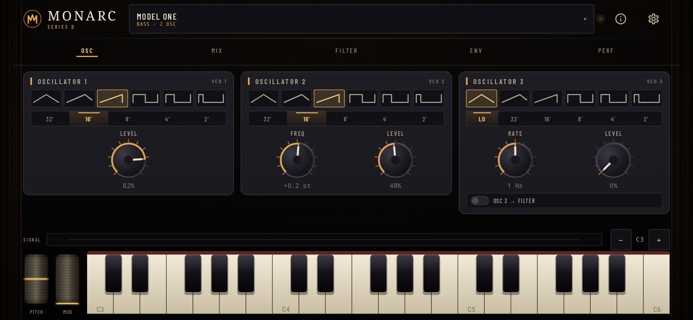

Monarch D is an original instrument, not a sample player. Three band-limited
oscillators feed a saturating four-pole transistor ladder, shaped by analog-style
envelopes, glide, drift and performance wheels. Every sample is generated on the
device in real time. There is no network permission, no sample library and no
account.

[](https://github.com/doodool-tala/Project2/actions/workflows/android.yml)

[**Download the APK**](apk/MonarchD-1.0.2.apk) · [Listen to the engine](#hear-the-engine) · [Install notes](apk/README.md) · [Controls](#controls) · [Build it yourself](#build-locally)

---

## Highlights

- **Three VCOs** with triangle, tri-saw, sawtooth, square, wide pulse and narrow
  pulse waves; 32', 16', 8', 4' and 2' ranges; fine tune; oscillator 3 can run as
  a low-frequency modulator and be routed into the filter.
- **A real ladder** — 24 dB/oct transistor-ladder low-pass with emphasis,
  keyboard tracking, contour amount and a dedicated ADS filter envelope.
- **Analog behaviour** — PolyBLEP band-limited oscillators, 2× oversampled
  nonlinear ladder saturation, drift, glide and a master drive stage.
- **Performance controls** — monophonic last-note priority, spring-loaded pitch
  wheel, performance mod wheel, true multi-touch keyboard and glissando.
- **A tactile panel** — five engraved pages, hand-drawn walnut cheeks, damped
  knobs, moving scope, peak meter, filter-response and envelope displays, plus
  a full patch library.
- **Twenty factory patches** across bass, lead, keys, pad and FX categories, with
  user-patch saving, search and randomisation.
- **Responsive** — portrait and landscape layouts, 25 keys on phones and 37 on
  wide screens, with two octaves of octave shift in either direction.
- **Private by design** — the only permission is vibration for haptics. The app
  has no internet permission and stores patches locally.

## Install

1. Download [`apk/MonarchD-1.0.2.apk`](apk/MonarchD-1.0.2.apk).
2. Open it on an Android 8.0+ device and allow installation from that source
   when prompted.
3. Launch **Monarch D**, then press **ENTER THE PANEL**.

The committed APK is the release build produced by GitHub Actions from the
source in this repository. On every push to `main`, the **Android Build**
workflow tests, builds and uploads the release variant, then publishes that
exact file and its SHA-256 checksum to `apk/` in a follow-up commit. The release
variant is currently signed with the standard Android debug key so that CI
artifacts are directly installable; see [release signing](#release-signing)
before publishing to Google Play. SHA-256 checksums accompany the APK in
[`apk/`](apk/).

## Hear the engine

These clips are not samples and were not recorded from a device. Each one was
rendered offline from the same `SynthVoice` used by the Android audio thread,
at 48 kHz / 16-bit mono, then peak-normalised to −1 dBFS:

- [**Fat bass with filter sweep**](docs/audio/01-fat-bass-filter-sweep.wav) — the
  *Model One* patch playing a C2–G2 bass line while the ladder opens and closes.
- [**Glide lead with mod wheel**](docs/audio/02-glide-lead-mod-wheel.wav) — a
  legato C-major phrase with portamento, vibrato and filter movement from the
  performance wheel.
- [**Resonant ladder**](docs/audio/03-resonant-ladder-self-oscillation.wav) — a
  high-emphasis sweep that pushes the four-pole ladder into controlled
  self-oscillation.

See [`docs/audio/README.md`](docs/audio/README.md) for the render settings and
the measured checks behind the clips.

## The instrument

### Oscillators

Three independent voltage-controlled oscillators cover the classic five decade
ranges, plus a low-frequency mode unique to oscillator 3. Each oscillator has
its own level in the mixer and its own place in the mix: oscillator 2 can be
detuned against oscillator 1, and oscillator 3 can broaden or animate the filter.
The oscillator output is band-limited with PolyBLEP, so high notes stay clean
without losing the edge of the original waveforms.

### Filter

The four-pole ladder is the centre of the instrument. Cutoff, emphasis and
contour amount are continuously variable; keyboard tracking can be off, one
third, two thirds or full. The filter contour is an ADS envelope with a switch
that removes sustain, while the loudness contour is a full ADSR. High emphasis
pushed into drive gets you from round rubber bass to a screaming lead.

### Performance

The voice is monophonic with last-note priority, exactly like the instruments
that inspired it. Glide ties notes together, drift gives every patch a subtle
analog instability, and the wheels control pitch bend, vibrato and filter
movement. The keyboard tracks multiple fingers for chords, legato playing and
true glissando, even though only the newest note speaks.

### Patches

Twenty carefully balanced factory patches are included, from the benchmark
**Model One** bass and **Rubber Funk** to **Celestial Choir**, **Cosmic Sweep**
and the clean **Init Patch**. The patch library can search factory sounds, save
your own patches by name, delete them and generate a random patch when you want
to discover something new. User patches live on the device, not in the cloud.

## Panel tour

| Page | What lives there |
| --- | --- |
| **OSC** | Three VCO cards: waveform, range, tune, level and oscillator 3 → filter |
| **MIX** | Oscillator, noise and drive levels; master output; signal path readout |
| **FILTER** | Cutoff, emphasis, contour, keyboard tracking, decay mode and response display |
| **ENV** | Filter ADS and loudness ADSR, with live contour previews |
| **PERF** | Glide, mod mix, drift, oscillator 3 modulation, randomise and panic |

## Visual verification

The Compose hierarchy is rendered to real bitmaps at three device classes:
phone portrait (390 × 844 dp), phone landscape (844 × 390 dp) and tablet
(1280 × 800 dp). All renders are produced by the JVM/Robolectric tests in
`app/src/test`, not by hand or by a mockup, and all 30 are committed under
[`docs/screenshots`](docs/screenshots/README.md).

### Phone portrait · 390 × 844 dp

<p align="center">
  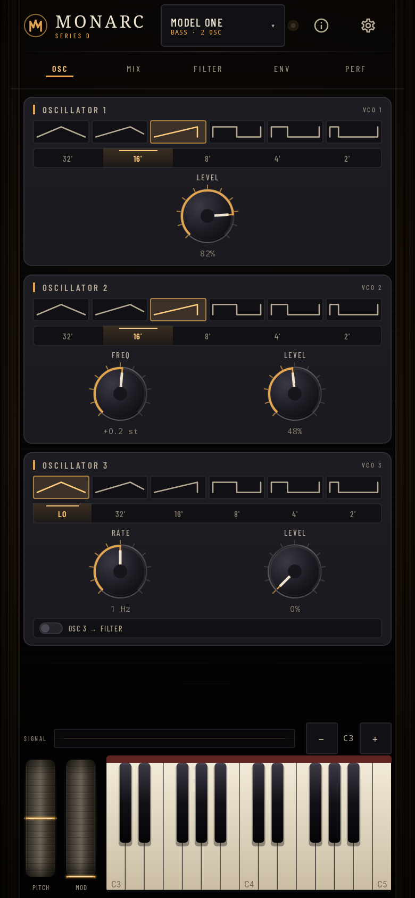
  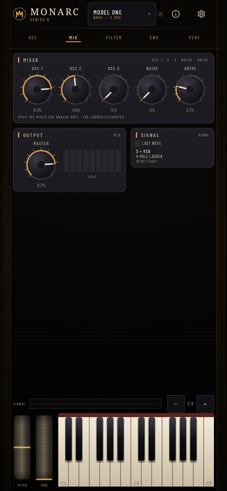
  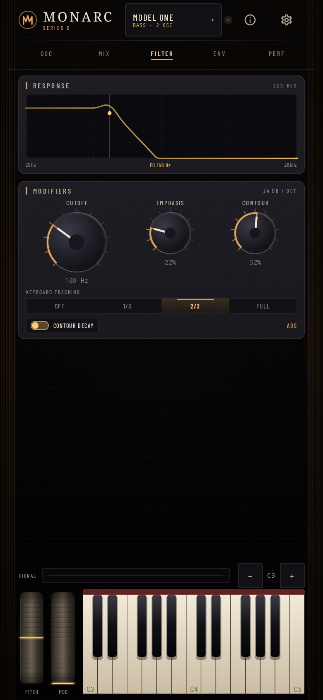
  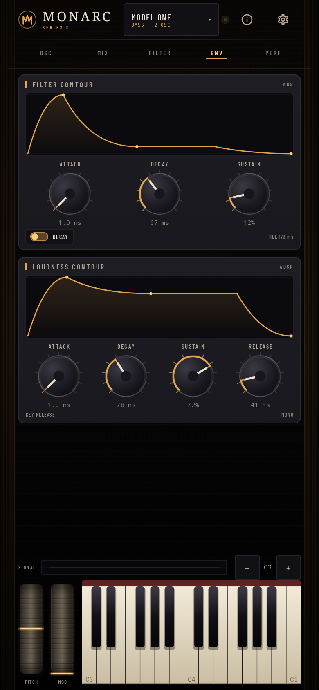
  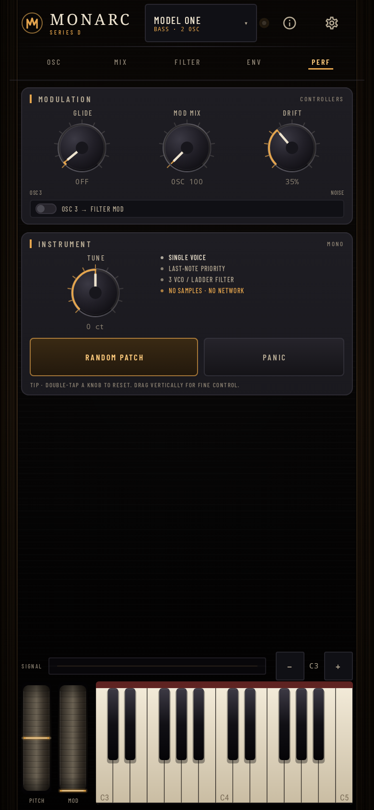
</p>

### Phone landscape · 844 × 390 dp

<p align="center">
  
  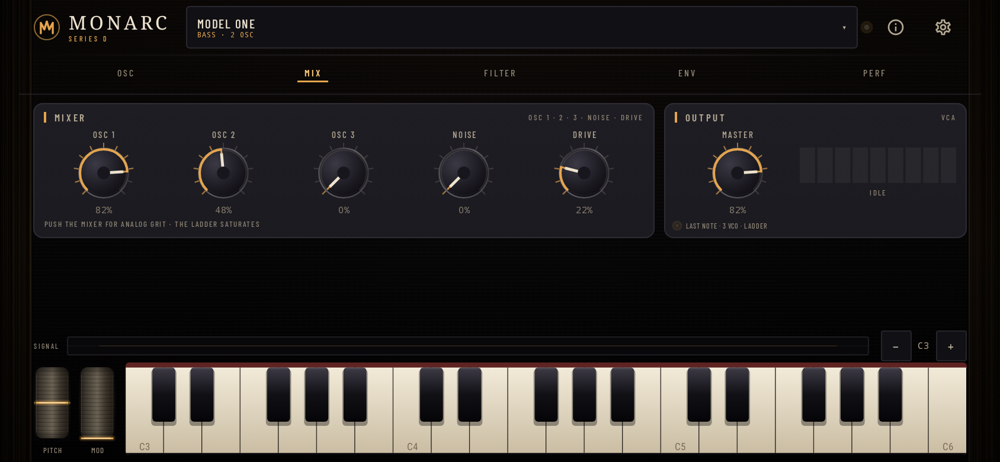
  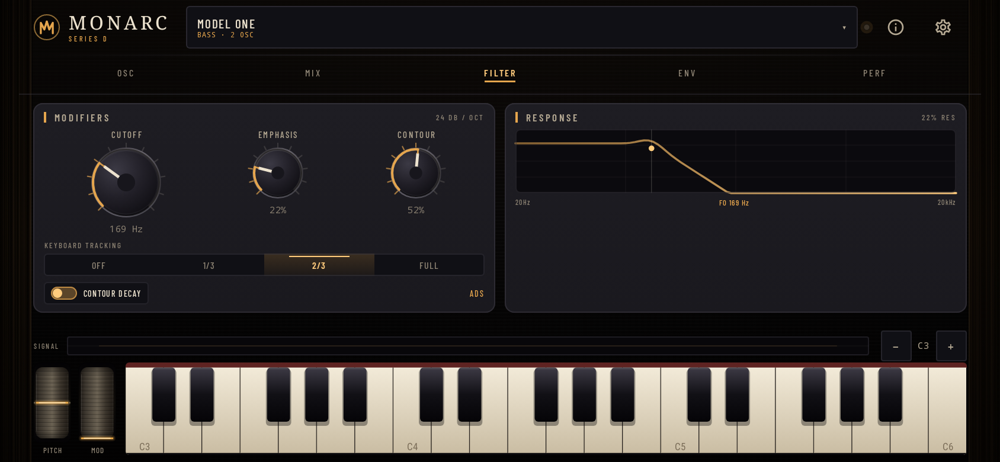
  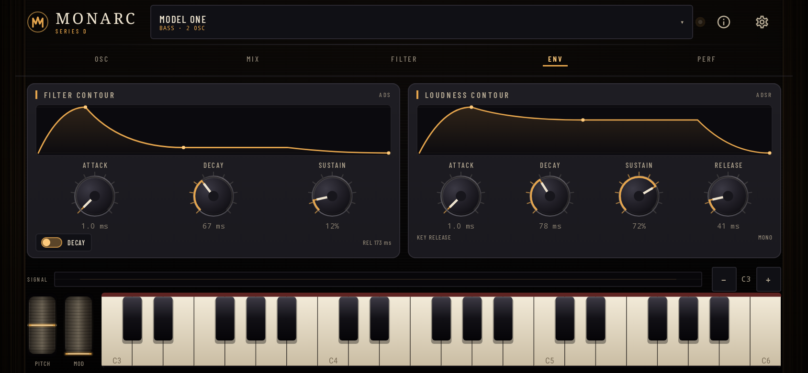
  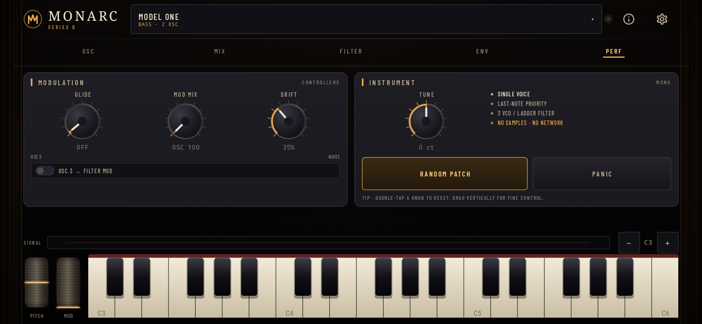
</p>

### Tablet · 1280 × 800 dp

<p align="center">
  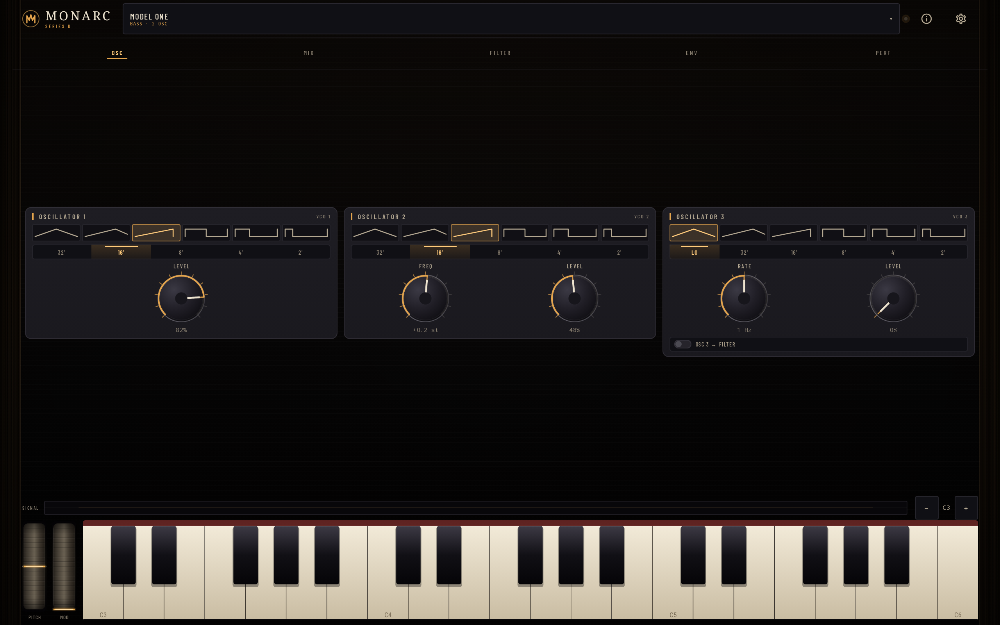
  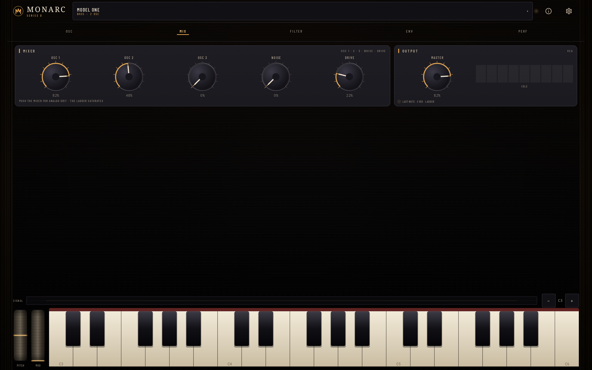
  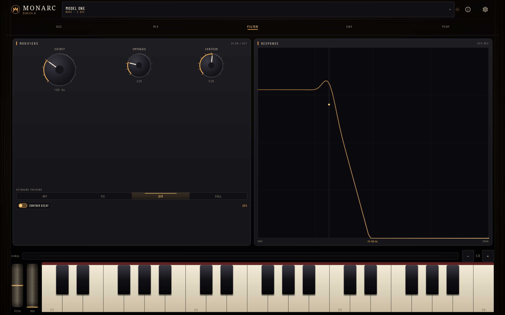
  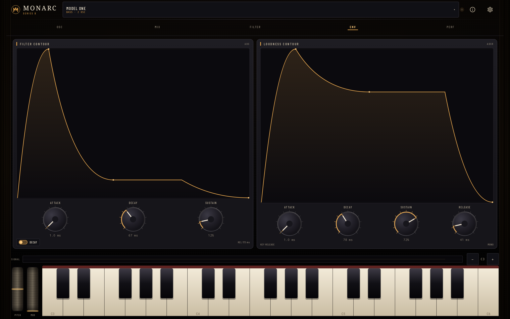
  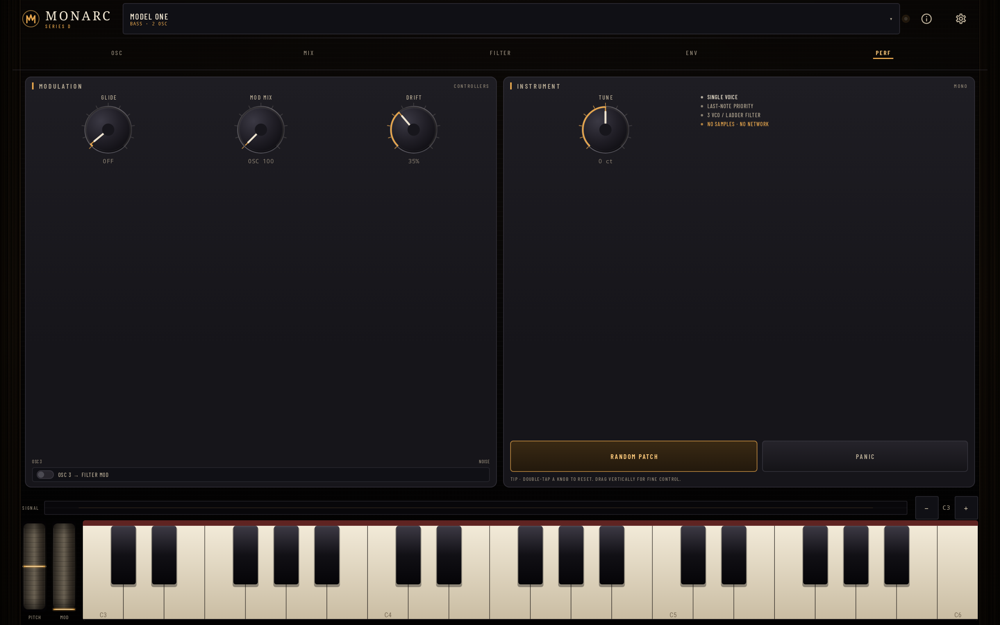
</p>

### Sheets, help, library and onboarding

<p align="center">
  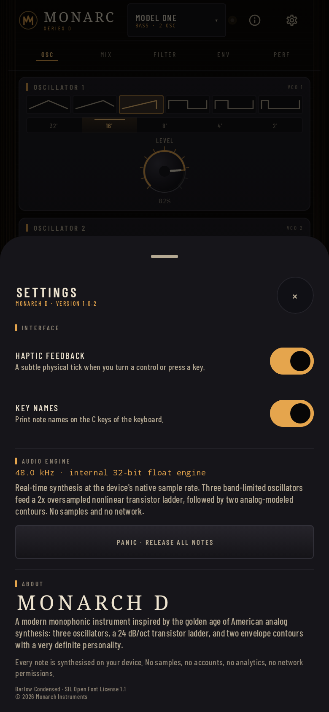
  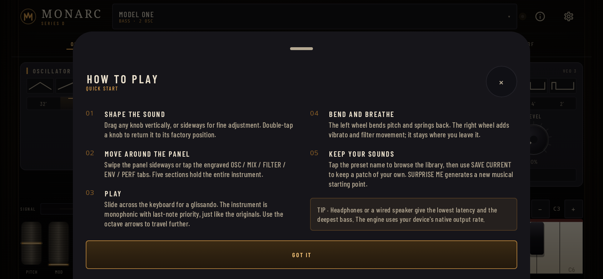
  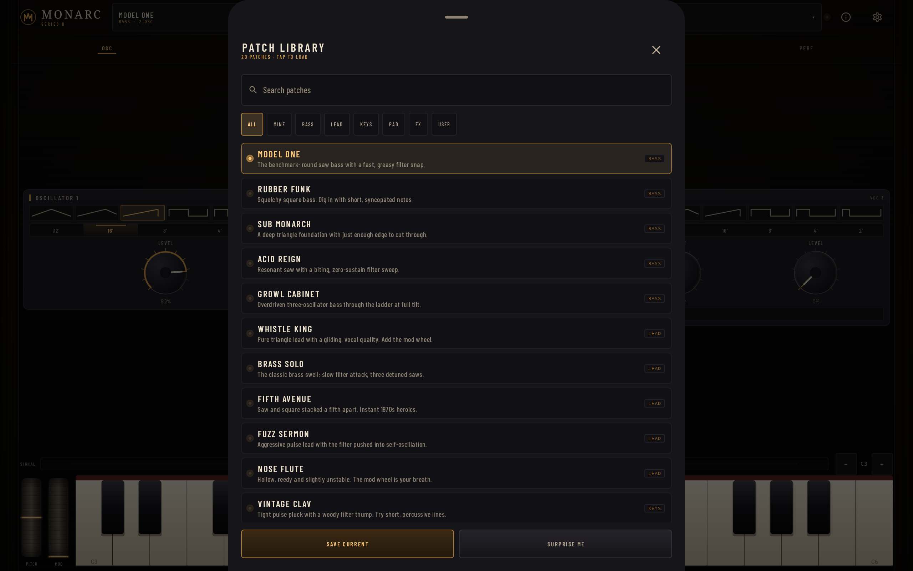
  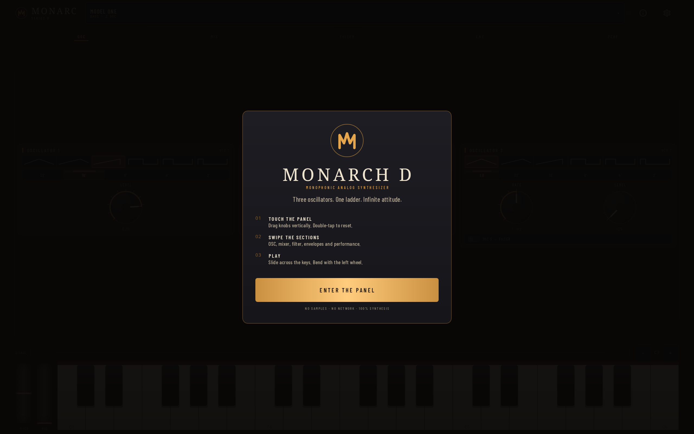
</p>

Every bitmap is an audit of the shipping Compose UI, including the separate
`ModalBottomSheet` windows used by Settings, Help and the Patch Library. The
renderer composites those dialog windows into the same frame as the instrument.

## Controls

- **Knobs** — drag vertically for coarse movement; drag horizontally for fine
  movement. Double-tap a knob to return it to its default.
- **Panel** — swipe left or right, or tap the OSC / MIX / FILTER / ENV / PERF
  tabs. The panel is scrollable in portrait.
- **Pitch wheel** — drag up or down and release; it springs back to centre.
- **Mod wheel** — drag up to add vibrato and filter movement; it stays where
  you leave it.
- **Keyboard** — touch and slide for glissando; multi-touch plays legato and
  chords with last-note priority. The octave stepper moves from C1 to C7.
- **Preset chip** — opens the patch library for searching, saving, deleting and
  randomising sounds.
- **Info / gear** — the in-app guide and settings for haptics, note labels,
  audio status and panic.

On first launch, a short engraved guide introduces the panel and the three
gestures that matter: touch, swipe and play.

<p align="center">
  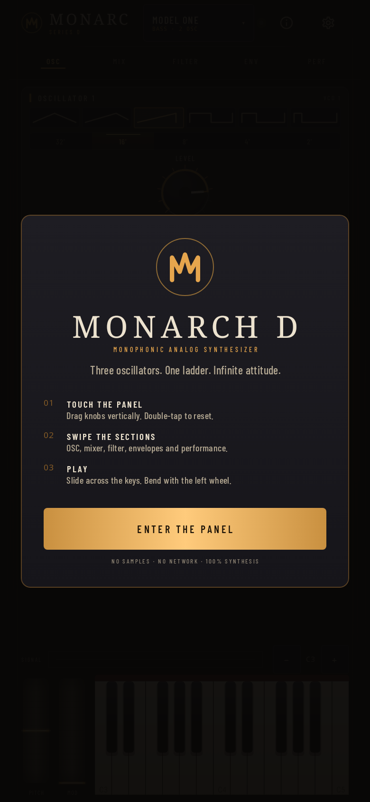
</p>

## Build locally

Requirements:

- JDK 17
- Android SDK platform 35 and build-tools 35 (Android Studio or the command-line
  tools)
- `ANDROID_HOME` or `ANDROID_SDK_ROOT` pointing at the SDK

```bash
./gradlew testDebugUnitTest
./gradlew assembleDebug
./gradlew assembleRelease
```

Outputs:

| Artifact | Path |
| --- | --- |
| Debug APK | `app/build/outputs/apk/debug/app-debug.apk` |
| Release APK | `app/build/outputs/apk/release/app-release.apk` |
| Panel renders | `app/build/screenshots/*.png` |

`testDebugUnitTest` runs the DSP tests, the offline audio-engine tests and the
Robolectric panel-render tests. The render tests draw the real Compose hierarchy
to PNGs, so they exercise layout, fonts, colours and drawing without an
emulator. The audio tests render the real voice at 48 kHz and inspect the
result with YIN pitch detection, FFT analysis and RMS envelopes; they do not
play a recording back.

## Continuous integration

Two GitHub Actions workflows live in [`.github/workflows`](.github/workflows):

- **Android Build** (`android.yml`) runs on pushes to `main`, pull requests and
  manual dispatch. It sets up JDK 17 and the Android SDK, caches and prefetches
  the Robolectric runtime, runs the complete unit-test suite, builds the debug
  and release APKs, verifies the release signature/package, and uploads both
  APKs and the rendered panel screenshots. On a push to `main`, it also copies
  the exact release APK it just built and its SHA-256 into `apk/`, then commits
  them back to `main`. This makes the download in this README traceable to a
  green workflow run rather than a hand-built binary. Pushing a `v*` tag
  attaches the release APK to a GitHub Release.
- **Publish APK to main** (`publish-apk.yml`) is a manual fallback that
  rebuilds the release APK, writes it to `apk/MonarchD-<version>.apk` together
  with a SHA-256 checksum, and commits both to `main`. The automatic publication
  above is the normal path.

The workflows use the runner's Android SDK and Gradle cache; no signing secrets
are required for the debug-signed release build.

## Project layout

```text
app/src/main/java/com/monarchd/synth/
├── audio/
│   ├── Dsp.kt              PolyBLEP oscillators, ladder filter, envelopes
│   ├── SynthVoice.kt       Voice rendering shared by the app and JVM tests
│   └── SynthEngine.kt      AudioTrack stream, note queue, audio focus
├── model/
│   ├── Patch.kt            Patch data and parameter mappings
│   ├── Presets.kt          20 factory patches
│   └── PatchRepository.kt  Local patch/settings persistence
├── ui/
│   ├── SynthApp.kt         Root layout, top bar, dock, background
│   ├── PanelPages.kt       Five panel pages and pager
│   ├── components/         Knobs, switches, graphs, keyboard, wheels
│   ├── PresetBrowser.kt    Patch library
│   ├── SettingsSheets.kt   Guide, intro and settings
│   └── theme/              Colours, type and instrument styling
└── SynthViewModel.kt       State, engine lifecycle, patch actions
```

The audio thread is separate from the UI, uses
`THREAD_PRIORITY_URGENT_AUDIO`, and requests audio focus. Output is stereo
32-bit float at the device's native sample rate, with a low-latency buffer sized
from `AudioTrack.getMinBufferSize` and the device's preferred frame count.

### Tests

- `DspTest` checks the oscillator/filter/envelope building blocks.
- `AudioEngineTest` renders the actual voice offline and asserts tuning across
  C1–C7, oscillator harmonic signatures, the ladder sweep and resonance peak,
  ADSR and filter-contour timing, drift, detune, last-note priority, glide,
  click-free note changes, DC offset and preset headroom.
- `PhonePortraitScreenshotTest` renders all five panel pages plus Settings/About,
  Help, the Patch Library and the first-run intro at 390×844 dp.
- `PhoneLandscapeScreenshotTest` renders the same surfaces at 844×390 dp.
- `TabletScreenshotTest` renders them at 1280×800 dp.

The fifteen render tests use Robolectric native graphics and write to
`app/build/screenshots`; the audited copies are committed in `docs/screenshots`.
They are regular JVM tests; no emulator or device is needed. The renderer also
composites Compose's separate dialog windows so the sheets are captured with the
instrument rather than as panel-only images.

### Offline audio results

The current suite renders more than twenty seconds of audio per run. Representative
measurements from the corrected engine:

| Check | Result |
| --- | --- |
| Tuning vs. A440, C1–C7 | worst error **+1.52 cents**; A440 **+0.07 cents** |
| Sawtooth / square / pulse harmonics | h2/h1 **0.491**; h3/h1 **0.332**; narrow-pulse h2/h1 **0.950** |
| Triangle h3 / h5 | **0.102 / 0.036** (the waveform’s expected odd harmonics) |
| Cutoff sweep, 0.15 → 0.90 | spectral centroid **117.4 → 1332.4 Hz** |
| Emphasis 0.13 → 0.90 | cutoff-band peak grows **0.13 → 63.6** |
| Attack / decay / release labels | measured **0.105 / 0.215 / 0.190 s** for 0.149 / 0.249 / 0.200 s labels |
| Oscillator drift | **±3.55 cents** at maximum; **0** when switched off |
| Factory patch headroom | maximum sample **0.587**; maximum DC **0.0031** |

These are hard assertions in `AudioEngineTest`, not annotations. They caught and
fixed three real engine faults: a ladder input that was saturating away the
triangle wave, a missing output DC blocker, and an attack stage that reached its
peak noticeably before the panel’s labelled time.

## Release signing

`app/build.gradle.kts` signs the release variant with the standard Android debug
key so that CI output can be installed directly. For a Play Store release:

1. Create an upload keystore and keep it out of the repository.
2. Replace the `signingConfig = signingConfigs.getByName("debug")` line with a
   `signingConfigs { create("release") { ... } }` block that reads the keystore
   from environment variables or a local properties file.
3. Increment `versionCode` / `versionName`.
4. Build a signed App Bundle (`bundleRelease`) and upload it to the Play Console.

Never commit a keystore or its passwords. The `apk/` directory is only for
convenient, directly installable development builds.

## Scope and limitations

This release is the instrument itself: monophonic synthesis, three oscillators,
one ladder filter, two contours and a performance keyboard. It does not include
MIDI/USB input, audio recording, or built-in reverb and delay effects. The
factory patches are designed to sound good dry and to take external effects
beautifully.

## License and trademarks

The application source is released under the [MIT License](LICENSE). The bundled
Barlow Condensed typeface is licensed under the SIL Open Font License 1.1; the
license text is included at
`app/src/main/assets/licenses/OFL-BarlowCondensed.txt`.

Monarch D is an independent project and is not affiliated with, endorsed by, or
licensed by Moog Music Inc. or Arturia. Product names from those companies are
trademarks of their respective owners. All code, graphics, presets and panel
design in this repository are original work inspired by the classic
transistor-ladder architecture.
